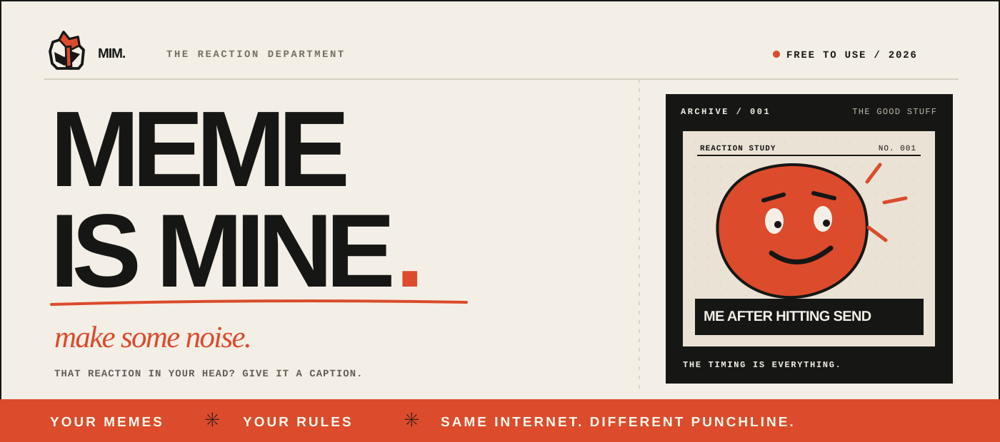
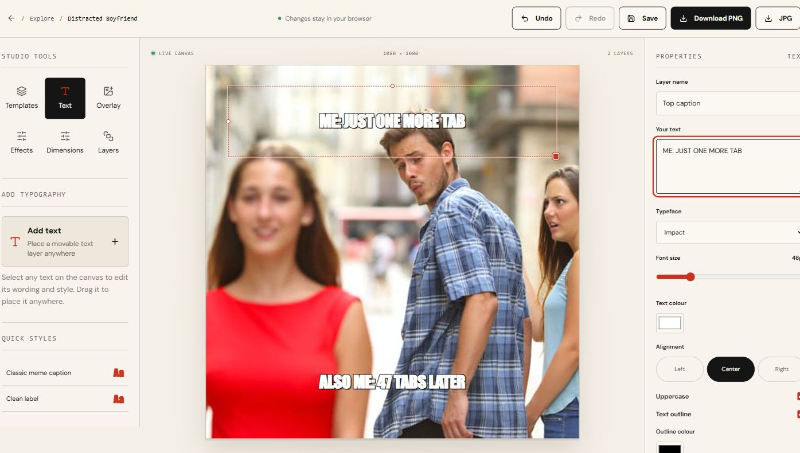

  

  <strong>THE FORMAT IS FAMILIAR. THE JOKE IS YOURS.</strong>
   
  A free little corner of the internet for making extremely important nonsense.

  <a href="https://memeismine.vercel.app"><strong>Open Meme Is Mine ↗</strong></a>
  &nbsp;&nbsp; / &nbsp;&nbsp;
  <a href="https://memeismine.vercel.app/explore">Image templates</a>
  &nbsp;&nbsp; / &nbsp;&nbsp;
  <a href="https://memeismine.vercel.app/video-templates">Video templates</a>

 

001 &nbsp;/&nbsp; THE IDEA

## You know the exact reaction. You just need to find it.

Someone drops the most questionable take in the group chat. You know *exactly* which face belongs in the reply. Now you're fifteen tabs deep, the moment has passed, and someone else has already sent "💀".

I wanted a better way.

**Meme Is Mine** is a free, browser-based meme studio for the space between *"I have a joke"* and *"sent."* It brings image templates, moving reactions, captions, and your saved work into one place. No complicated setup. No trying to convince an AI to understand your sense of humor.

Just find the moment and make it yours.

---

002 &nbsp;/&nbsp; THE GOOD STUFF

## Your next inside joke lives here.

<table>
  <tr>
    <td width="50%" valign="top">
      01 &nbsp;—&nbsp; THE IMAGE ARCHIVE
      <h3>Find the face.</h3>
      
Classic formats, oddly specific reactions, and the image that says what your paragraph never could.

      <a href="https://memeismine.vercel.app/explore">Browse image templates ↗</a>
    </td>
    <td width="50%" valign="top">
      02 &nbsp;—&nbsp; THE MOTION DEPARTMENT
      <h3>Make it move.</h3>
      
Browse video reactions and GIFs, watch silent looping previews, then put your own words over the moment.

      <a href="https://memeismine.vercel.app/video-templates">Browse video templates ↗</a>
    </td>
  </tr>
  <tr>
    <td width="50%" valign="top">
      03 &nbsp;—&nbsp; THE WORKSHOP
      <h3>Rewrite the scene.</h3>
      
Position captions, make a few creative decisions, and export an image or video meme. The joke stays yours.

      <a href="https://memeismine.vercel.app/create/upload">Use your own image ↗</a>
    </td>
    <td width="50%" valign="top">
      04 &nbsp;—&nbsp; YOUR STUDIO
      <h3>Keep the good ones.</h3>
      
Save drafts, bookmark formats, and revisit the memes you liked. For when the joke is too good to lose.

      <a href="https://memeismine.vercel.app/studio">Go to Studio ↗</a>
    </td>
  </tr>
</table>

 

FIG. 01 &nbsp;/&nbsp; INSIDE THE WORKSHOP

  

003 &nbsp;/&nbsp; THE PROCESS

## Find it. Caption it. Send it.

**01 — Pick your format.** A familiar image, a reaction clip, or something from your own camera roll.

**02 — Make the joke.** Change the caption, adjust the composition, and preview the result. No auto-generated punchline pretending to be funny.

**03 — Drop it in the chat.** Download your finished meme. Let the replies do the rest.

> **This is not a joke generator.** It's a good place to make your own.

---

004 &nbsp;/&nbsp; THE BORING QUESTION, ANSWERED

## Yes, it's free.

Browse images and preview videos without an account. Want to edit, save drafts, and like templates? Create a **free account**, verify your email, and you're in. No subscription required.

Your drafts, bookmarks, and uploads are kept in the browser on your device. They **don't automatically sync between devices**; clearing site data can remove them. Studio includes a manual backup option.

Some clips live on external sites, so availability and video exports can depend on the source file and your browser. Please use media you have the right to edit or share.

  
<strong>For the curious: what's under the hood?</strong>

   

  Meme Is Mine runs on **Next.js, React, TypeScript, and Motion**, with browser-based image/video editing and **Appwrite** handling accounts and template likes.

  The development environment expects **Node.js 24**.

  ~~~bash
  npm ci
  cp .env.example .env.local
  npm run dev
  ~~~

  Set up your own server-side Appwrite credentials in \` .env.local \` using the guidance in [MEMBERSHIP-SETUP.md](MEMBERSHIP-SETUP.md). Never put private API keys in client-side variables or commits.

  ~~~bash
  npm run lint
  npm run typecheck
  npm run test:auth
  npm run test:video
  npm run build
  ~~~

 

---

  AN INDEPENDENT LITTLE EXPERIMENT IN INTERNET CULTURE
    
  <strong>Good memes travel. Great timing makes them land.</strong>
   
  Made by Raj Suhandani.
    
  <a href="https://memeismine.vercel.app"><strong>MAKE SOME NOISE ↗</strong></a>

